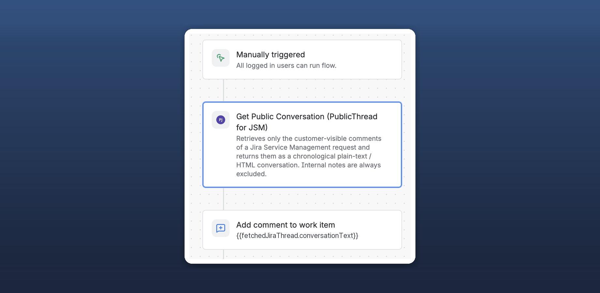

# PublicThread for JSM

Get only the customer-visible conversation of a Jira Service Management request inside a Jira Automation rule, as plain text or HTML.

[Get it on the Atlassian Marketplace](https://marketplace.atlassian.com/apps/2407939928/publicthread-for-jsm) · [Documentation](https://asunokio-official.github.io/publicthread-jsm-docs/documentation.html) · [Quick start](https://asunokio-official.github.io/publicthread-jsm-docs/documentation.html#quick-start)

*Sample site and test data.*

## What it solves

When a rule sends an email or writes a summary of a request, you often want only what the customer could see, without internal notes. PublicThread adds one Automation action that returns the public comments as one transcript, so you do not have to filter comments yourself.

## Who it is for

Jira Service Management admins and agents who build Automation rules that email, summarize or report on request conversations.

## What it does

- One action: **Get Public Conversation (PublicThread for JSM)**.
- Returns the most recent public comments (1–50, default 10) in chronological order.
- Options: show author name, show timestamp, include or leave out public replies from agents.
- Internal notes are always excluded. There is no setting to include them.
- Output smart values for later steps: `{{fetchedJiraThread.conversationText}}`, `{{fetchedJiraThread.conversationHtml}}` and `{{fetchedJiraThread.commentCount}}`.

## Limits to know about

- It reads comments; it does not send emails itself. Use it with the Send email or Add comment actions.
- It reflects the access of the account that runs the rule. If that account cannot view the request, the output is empty.
- Leaving out agent replies relies on the request's reporter and participants to identify customers. If that information cannot be retrieved, agent replies are not excluded, and internal notes are still never included.
- Jira's built-in smart values can also loop over comments. This app is a convenience when you want a ready-made public transcript.

## Install

A Jira administrator installs the app from the [Marketplace listing](https://marketplace.atlassian.com/apps/2407939928/publicthread-for-jsm) with **Try it free**. If you are not an administrator, the listing lets you submit a request to your administrator.

## Guides

- [Email only the public comments of a JSM request with Jira Automation (native template vs this app)](https://asunokio-official.github.io/publicthread-jsm-docs/email-public-comments-automation.html)

## Support

Use the [ASUNOKI support page](https://asunoki.jp/support/) or email [support@asunoki.jp](mailto:support@asunoki.jp). Both are private.

**Please do not open public GitHub issues for support.** Issues in this repository are public: never post customer names, email addresses, request content, site data, API tokens or passwords there (or anywhere public). We never need a password or token to help you.

See also the [Privacy Policy](https://asunokio-official.github.io/publicthread-jsm-docs/privacy-policy.html).

Vendor: Seisuke Nagahara (ASUNOKI). An independently developed Marketplace app, not affiliated with or endorsed by Atlassian beyond the standard Marketplace listing.
